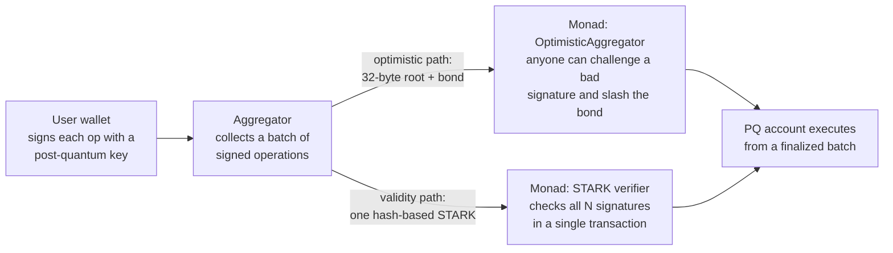
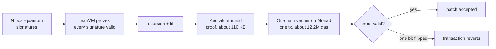

<div align="center">

# Sigpress

### Post-quantum signatures without losing Monad's throughput

One hash-based proof replaces a whole batch of post-quantum signatures, so Monad can go quantum-safe
**without a 90% cut in block capacity.**

[-836EF9)](https://testnet.monadexplorer.com)
[](LICENSE)
[](https://blitz.devnads.com)
[](https://aman035.github.io/sigpress/)

</div>

---

## The problem

**Monad is fast because it rations bytes.** A block is capped at **1.5 MB and 3,750 transactions**, every
**300 ms** ([MIP-12](https://mips.monad.xyz/MIPs/MIP-12)). That budget only works because an ECDSA
signature is **65 bytes**, so an average transaction is ~400 bytes and 3,750 of them fit.

**Quantum computers break that signature.** Shor's algorithm recovers an ECDSA private key from its public
key, so the day a large quantum computer exists, any account whose key has touched the chain can be
drained. The fix is **post-quantum signatures**, but they are **10 to 120x bigger**: ML-DSA-44, the scheme
in Monad's own account-auth draft, is **~3.7 KB** (signature + key).

**Put those on chain and the signature *is* the transaction**, so far fewer fit in a block:

| Signature | Bytes/tx | Tx per 1.5 MB block | vs ECDSA |
|---|---:|---:|---:|
| ECDSA (today) | ~400 | **3,750** | - |
| ML-DSA-44 (Monad's PQ draft) | ~4,067 | **~370** | **-90%** |
| Falcon-512 | ~1,001 | ~1,500 | -60% |
| SLH-DSA-128s | ~8,191 | ~183 | -95% |

<sub>Capacity ceiling from [MIP-12](https://mips.monad.xyz/MIPs/MIP-12) + [FIPS 204](https://csrc.nist.gov/pubs/fips/204/final): a capacity limit, not a live-TPS claim.</sub>

At MIP-12's ~400 B/tx model that's a **~90% capacity cut** for ML-DSA; even at today's *measured* mainnet
mix (~1,728 B/tx average) it's still a **58 to 76% cut**. Either way, quantum-safe Monad is a far slower
Monad.

**And it's coming, unaddressed.** NIST finalized the PQ signature standards in 2024, Ethereum targets a
quantum-safe L1 by ~2029, and Monad has published a PQ roadmap, but that roadmap makes accounts
quantum-safe **without once mentioning signature size**, and Monad's own consensus paper *Quantum Cadence*
gave up on aggregate signatures because "no post-quantum scheme matches BLS." Nobody has even sized this
problem, let alone solved it.

**Sigpress's answer:** don't put the signatures on chain, put **one hash-based proof** that they were all
valid, and let Monad check the proof once. Users still sign with quantum-safe keys; a post-quantum
operation costs **98 bytes** on chain instead of 2,276 (**23x smaller**, measured on testnet today).

---

## What we built, live and measured on Monad testnet

> **Headline: 2,048 post-quantum signatures, each over its own message, verified on Monad in ONE
> transaction by a hash-based STARK.** 23.2M gas charged, about 11.3k gas and 116 B per signature, no
> trusted party ([tx](https://testnet.monadexplorer.com/tx/0x97e2a519475fbe284637707e0682f5e8e882bf2dfb2f96f4099766e7472a2ec1)). The contract checks the proof against the raw public keys and messages
> in calldata. Optimistic aggregation (root, bond, challenge) is live too, as the fallback. Every number
> below is measured on Monad testnet; the tx links go to the explorer.

| | Measured on Monad testnet |
|---|---|
| 🟢 **Batch of 256 ops to one 32-byte root** | **102,063 gas · 0.89 bytes/op of signature overhead** |
| 🟢 **Compact bundle: 128 PQ ops executed in one tx** | **98 bytes/op on chain** · ~27k gas/op ([tx](https://testnet.monadexplorer.com/tx/0xf37a32806cda56f3493d2880bf181df2abf0c084e2894e87dca7edd7df1defbd)) |
| ⚪ Naive PQ (one signature on chain) | 118,606 gas · 2,276 bytes |
| 🔪 **Tamper one signature** | `challenge` then **bond slashed, batch rejected on chain** |
| 👤 PQ 4337 account executes from a finalized batch | ~134,634 gas |
| 🔗 Standard `handleAggregatedOps` (EntryPoint v0.8) | 4-op aggregated bundle executes (828,003 gas) |
| 🧮 **STARK verifier (hash-based, no pairings)** | deployed on Monad, **verifies a proof in one tx (~12.84M gas)**; tampered proof reverts |
| 🧮 **2,048 signers, own messages, one tx (STARK, trustless)** | **23,188,637 gas charged, 237,956 B calldata** ([tx](https://testnet.monadexplorer.com/tx/0x97e2a519475fbe284637707e0682f5e8e882bf2dfb2f96f4099766e7472a2ec1)); tampered proof, changed signers or messages, and replay all revert |
| 🧮 **Our own signatures through the STARK chain** | 2 x 4 leanXMSS sigs to terminal proof, **verified on Monad, one tx, ~12.2M gas** ([tx](https://testnet.monadexplorer.com/tx/0x55212a0000c95dd33fcdc9510a32434afe1143dd73b1391bcde0098d79904f92)); tampered proof and swapped roots revert |
| ⚙️ Prover | **1,024 signatures to 326 bytes/sig in 2.29 s** (~61 B/sig with recursion) |

---

## Try it

**Live demo page (animated run, shareable): https://aman035.github.io/sigpress/**

### Interactive wallet — send a real post-quantum transfer on Monad testnet

A browser wallet that sends real transfers through the aggregator service to Monad, showing every phase
(the one-time key, the signed message, the 2,144-byte signature, the batch root, and every tx). Needs a
funded key in the root `.env` (`PRIVATE_KEY_K13`).

All commands run from `aggregator/`, so each line below `cd`s there first.

```sh
cd aggregator && pnpm install                            # first time only

# terminal 1 — the aggregator service (fast 8-second window instance baked in)
cd aggregator && KEY_VAR=PRIVATE_KEY_K13 pnpm wallet:service   # wait for http://127.0.0.1:8547

# terminal 2 — the wallet (serves the UI, signs, relays) — start AFTER the service is up
cd aggregator && KEY_VAR=PRIVATE_KEY_K13 pnpm wallet      # then open http://127.0.0.1:8550
```

Open **http://127.0.0.1:8550**, pick a post-quantum account, and send. Watch it go signed → queued →
batched on Monad → finalized → executed, with live explorer links; "Forge a bad op" shows the aggregator
reject a tampered signature. Full guide and env in [`docs/wallet-demo.md`](docs/wallet-demo.md). For the
on-chain slash of a withheld/dishonest batch, also run `KEY_VAR=PRIVATE_KEY_K13 DA_URL=http://127.0.0.1:8547 pnpm watchtower`
and `KEY_VAR=PRIVATE_KEY_K13 pnpm service:tamper`.

### Tests and the one-shot CLI demo

```sh
cd contracts && forge test                    # 93 Solidity tests
cd aggregator && pnpm install && pnpm test    # TS tests
./scripts/testnet.sh                          # one-shot: deploy + batch + tamper on testnet
```

---

## How it works

Users keep signing every operation with a post-quantum key. The aggregator batches those operations and
gives Monad **one thing to check** instead of thousands of signatures, on either of two paths:



The proof is hash-based end to end (Keccak Merkle + Fiat-Shamir + a WHIR commitment): no pairings, no
trusted setup, no BLS, no Groth16. That is what makes it quantum-safe, unlike the Groth16/PLONK SP1
gateways already on Monad.

**Inside the validity path**, a whole batch of signatures collapses into one small proof that the
contract checks cheaply:



---

## Why Monad, not any other chain

1. **The byte budget *is* Monad's product.** PQ signatures eat 60 to 95% of block capacity on any full
   chain; on a throughput chain that's the binding constraint, which is exactly what aggregation removes.
2. **The verifier fits *and* is cheap (measured).** Our STARK verifier is **62.7 KB: it deploys under
   Monad's 128 KB limit but would *not* fit Ethereum's 24 KB**, and a proof verifies for **~12.84M gas**
   (Monad gives 30M gas *per tx*; Ethereum gives 30M per *block*).
3. **The rails and the gap are already here.** ERC-4337, EIP-7702 and a P-256 precompile are deployed, and
   Monad's roadmap leaves the size question open. We ship it at the **app layer, today.**

> **Credit:** the aggregation idea is **EIP-8288's** (Buterin & Coratger): proposed for Ethereum's
> protocol, needing a hard fork, not working anywhere yet. Sigpress is a working **app-layer
> implementation** of that design on Monad, with the on-chain verifier it only specifies. We build on
> 8288; we don't claim the concept.

---

## Honest limits

- **The validity proof is a working prototype, not the shipped path yet.** It already verifies real
  signature batches on Monad, and it now binds trustlessly: the contract recomputes the batch from the
  signers and their per-operation messages on chain (no trusted helper), and swapped batches, changed
  messages or tampered proofs revert. It also scales: binding v2 verifies **2,048 signatures with distinct
  messages in one Monad transaction** (~3.2k gas per signer). What still needs hardening is production fit:
  the prototype uses a research key format rather than our production accounts, and proving a batch takes
  about a minute. Until those close, the live product path stays the simpler optimistic one.
- **Keys are single-use.** Hash-based signatures use one-time keys, so the wallet rotates to a fresh key
  on every operation and never reuses one.
- **Every figure is real.** Each number is measured on Monad testnet with a transaction you can open, or
  clearly marked as a capacity model.

---

## Contracts

**Deployed by us** (chain 10143, source-verified on MonadVision / Sourcify):

- **NaiveLane** `0xcFc286564ed4281E200c6D052f9E1A932b31E845`
- **OptimisticAggregator** `0xEAA3AC4807767F8fe5B8caD979cB523A926b2A1E`
- **PQAccountFactory** `0x7335b48f2d794d4a196618916Ec196a1a1615442`
- **SigpressAggregator4337** `0xe6869caa26a2581880a8d237c1a1f9a26c6c212e`
- **PQAccount4337Factory** `0x21d2ee544075fb5da08bc44bd9a68f6d736e6563`

**Pre-existing infrastructure we build on (not ours):** the canonical ERC-4337 EntryPoint v0.8
(`0x4337084D9E255Ff0702461CF8895CE9E3b5Ff108`, the standard cross-chain deployment, already live on
Monad) and Monad's own native P-256 precompile. Our on-chain STARK verifier is generated from the
third-party `sol-spartan-whir` research code, not written by us.

Layout: `contracts/` (Solidity), `aggregator/` (TS aggregator + SDK), `web/` (demo page).

---

<div align="center">
<sub>Built at Monad Blitz · MIT licensed · post-quantum, on the chain that needs it first.</sub>
</div>
